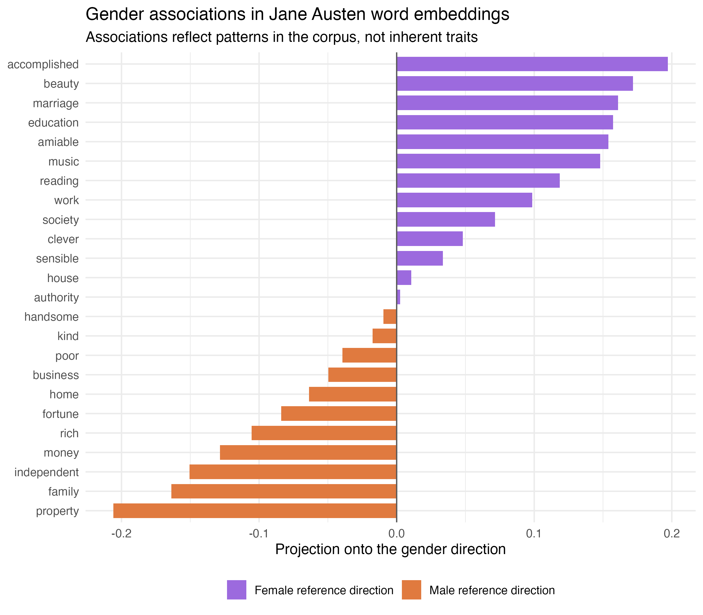
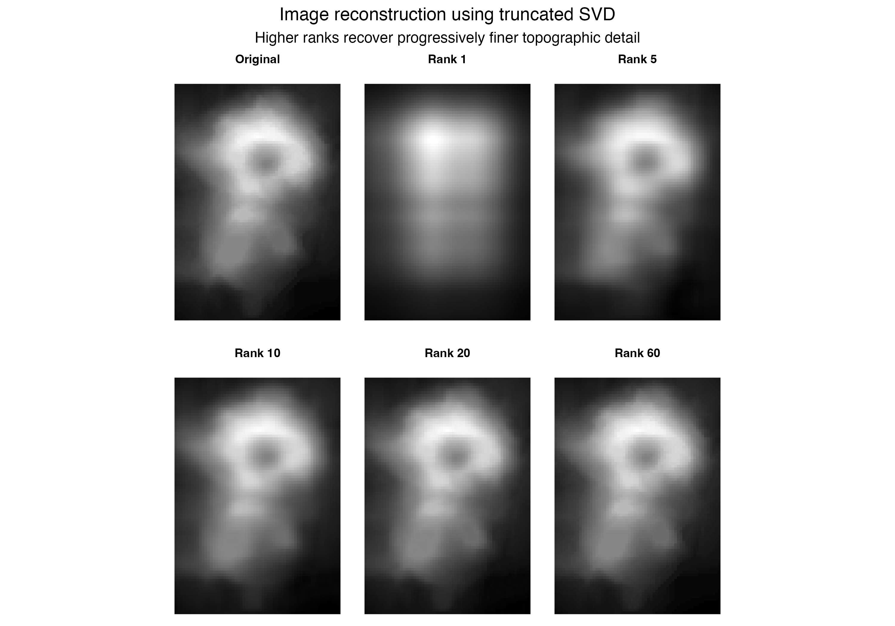

# Low-Rank Methods in Practice

An R project exploring how singular value decomposition (SVD) can uncover
structure in text and compress image-like matrices. The analysis builds word
embeddings from six Jane Austen novels and applies truncated SVD to a grayscale
topographic surface.

This repository is an independent portfolio extension of concepts I studied in
McGill's MATH 308 course. The public version uses reproducible, non-confidential
data and a redesigned analysis.

[Read the Quarto report](analysis/report.qmd) ·
[Open the rendered HTML report](analysis/report.html)

## Results at a glance

- Built a symmetric, weighted `3,000 x 3,000` word co-occurrence matrix using a
  five-word context window.
- Learned 100-dimensional word embeddings with a sparse truncated SVD.
- Recovered meaningful semantic and narrative relationships: `love` is close to
  `affection`, `heart`, and `attachment`, while `elizabeth`, `darcy`, `bingley`,
  and `wickham` form a recognizable character network.
- Measured corpus-specific gender associations using eight reference word pairs
  and documented the interpretive limitations of those projections.
- Reduced storage for a rank-10 image approximation by about 72% while keeping
  relative reconstruction error near 1.45%.

## Word embeddings

The text pipeline tokenizes the novels, removes punctuation, numbers, symbols,
and English stopwords, and retains the 3,000 most frequent words. It constructs
a distance-weighted co-occurrence matrix, applies `log(1 + x)`, and computes the
top 100 singular components. Row-normalized vectors are compared with cosine
similarity.



The embeddings capture both semantic relationships and the narrative structure
of the novels. Because the corpus represents a specific historical and literary
setting, associations should not be generalized to modern language or society.



## Image compression

The built-in `volcano` topographic matrix is treated as a grayscale image and
reconstructed with rank-k approximations:

```text
A_k = U_k D_k V_k^T
```

Low ranks preserve broad structure with substantial storage savings. As rank
increases, reconstruction error decreases, but the factorized representation
eventually becomes larger than the original matrix.



## Repository structure

```text
R/          Reproducible analysis scripts, run in numerical order
analysis/   Quarto source and rendered HTML report
data/       Data provenance notes
figures/    Generated visualizations
results/    CSV summaries of the main results
```

## Reproduce the analysis

Install the required packages:

```r
install.packages(c(
  "janeaustenr",
  "quanteda",
  "irlba",
  "ggplot2",
  "dplyr",
  "here"
))
```

Run the scripts from the project root:

```r
source("R/01_build_corpus.R")
source("R/02_fit_embeddings.R")
source("R/03_explore_embeddings.R")
source("R/04_analyze_gender_associations.R")
source("R/05_image_compression.R")
```

Intermediate matrices and embeddings are stored in the ignored `cache/`
directory. Tables and figures are written to `results/` and `figures/`.

## Limitations

The results depend on the selected corpus, vocabulary size, context window,
stopword list, embedding dimension, and reference words. Word-vector
associations describe statistical patterns in the corpus; they do not establish
causal relationships or inherent human traits. The compression example uses a
small topographic matrix, so performance on photographs may differ.
